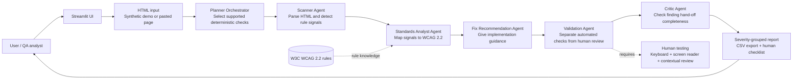

# AccessAble AI — Architecture Diagram

## Agent hand-off contract

| Agent | Receives | Produces | Decision |
|---|---|---|---|
| Planner Orchestrator | HTML | Supported check plan or empty-input status | Is there valid input and which deterministic checks apply? |
| Scanner | HTML and plan | Structured rule signals | Which detectable barriers are present? |
| Standards Analyst | Signals | WCAG criteria and rationale | Which accessibility standard applies? |
| Fix Recommendation | Analysed findings | Concrete fix and code example | What should the developer change? |
| Validation | Recommended findings | Automation status and human checklist | What can be verified automatically? |
| Critic | Validated findings | Completeness notes | Does every reported finding have standards, fix and validation guidance? |

The agents are deterministic Python functions in this PoC so their work can be tested and demonstrated reliably. An LLM could later enrich recommendations, but should not replace rule-based validation or human judgement.
