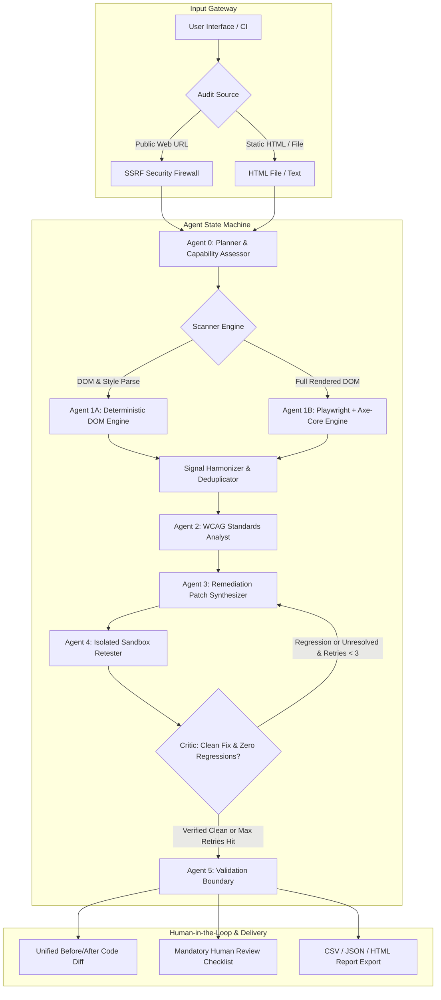

# AccessAble AI — Architecture & Agent Orchestration

AccessAble AI is an autonomous, multi-agent accessibility auditing and remediation engine built to detect Web Content Accessibility Guidelines (WCAG 2.2) barriers and synthesize verified, non-destructive code patches.

## Agent Hand-Off Contracts

| Agent | Input State | Output State | Core Decision Logic |
|---|---|---|---|
| **Agent 0: Planner** | Input HTML or validated URL | Structured Execution Plan | Validates URL against SSRF firewall; selects optimal engine (Playwright vs. Python DOM). |
| **Agent 1: Scanner** | HTML or live URL | Raw Finding Signals | Detects WCAG violations (missing alt, unlabelled forms, contrast, heading order, link text). |
| **Agent 2: Standards Analyst** | Raw Finding Signals | Normative WCAG Mappings | Cross-references violations to specific WCAG 2.2 Success Criteria (1.1.1, 1.3.1, 1.4.3, 2.4.2, 2.4.4, 3.1.1). |
| **Agent 3: Remediation Agent** | Normalized Findings | Proposed Replacement Patches | Synthesizes contextual code fixes for offending DOM nodes. |
| **Agent 4: Critic & Retester** | Original HTML & Candidate Patches | Retest Results & Unified Diffs | Applies patch in isolated memory buffer; re-runs scanner; verifies resolution and flags new regressions. |
| **Agent 5: Validation Boundary** | Verified Results | Human Checkpoints & Exports | Explicitly distinguishes automated checks from mandatory assistive tech human verification. |

## Defense in Depth: Security Model
- **SSRF Protection**: Target URLs are validated using DNS pre-flight inspection against RFC 1918 private subnets, loopback addresses (`127.0.0.1`), link-local metadata endpoints (`169.254.169.254`), and non-HTTP protocols.
- **Isolated Sandbox**: Fixes are never applied directly to production files or live servers; all patches are computed and verified within an isolated in-memory buffer.
