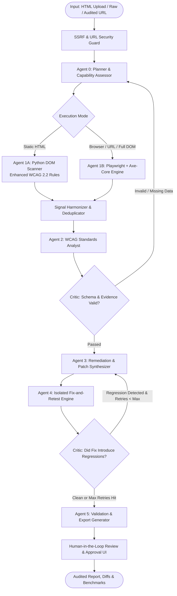

# AccessAble AI — Implementation Roadmap & Repository Audit
**Project**: AccessAble AI — Multi-Agent Website Accessibility Auditor  
**Author**: Priyansh Pandey  
**Date**: October 2026  
**Status**: In Progress (Transforming to Competition-Ready Agentic AI Project)  

---

## 1. Executive Summary & Audit Findings

An exhaustive inspection of the existing codebase (`app.py`, `audit_engine.py`, `sample_pages.py`, `architecture.md`, `README.md`, `requirements.txt`, `tests/`, `deliverables/`) was conducted.

### 1.1 Working Features Preserved
- **Core 5-Rule Deterministic Engine**: `IMG_ALT`, `FORM_LABEL`, `PAGE_LANG`, `PAGE_TITLE`, `COLOR_CONTRAST`.
- **Streamlit Framework**: Clean baseline UI with sample pages (`BROKEN_STORE_PAGE`, `IMPROVED_STORE_PAGE`), graphviz pipeline visualization, and CSV export.
- **Defensive Parsing**: Basic fallback if HTML parser encounters unhandled formatting.
- **Academic CA-3 Deliverables**: Presentation (`deliverables/AccessAble_AI_CA3_Presentation.pptx`), Report (`deliverables/AccessAble_AI_CA3_Final_Report.docx`), script, and docs are intact and preserved without modification.

### 1.2 Identified Bugs & Flaws in Existing Detection
1. **Decorative Images (`alt=""`) Treated as Missing**:
   - `audit_engine.py` line 114: `if "alt" not in attrs or not attrs["alt"].strip():` flagged `alt=""` as an error. Per WCAG 1.1.1 (Technique H67), null alt (`alt=""`) is the standard semantic way to mark decorative or redundant images. Flagging it produced false positives.
2. **Accessible Names (ARIA & Nested Labels)**:
   - Form label checking only checked `attrs.get("id") in parser.labels_for` or `aria-label`/`aria-labelledby`/`title`. It did not account for wrapping `<label><input ...></label>` without a `for` attribute, nor button inner text, nor ARIA role overrides (`role="presentation"`).
3. **Contrast Calculation**:
   - Only parsed inline style attributes matching basic hex regex (`#fff` or `#ffffff`) or 7 hardcoded color names. Failed on `rgb()`, `rgba()`, `hsl()`, CSS classes, inherited styles, or external stylesheets. Did not differentiate between normal text (4.5:1) and large text (>= 18pt or 14pt bold -> 3:1).
4. **Element Locators & Evidence**:
   - Locators were just string snippets like `` without CSS selectors, XPath, or line-number context, making programmatic patching impossible.
5. **No Actual Iterative Orchestration**:
   - The "multi-agent" pipeline was a purely linear sequence of 6 Python function calls (`planner -> scanner -> standards -> fix -> validation -> critic`). There was no state machine, no conditional routing, no retry logic, no critic rejection, and no verification that recommended fixes actually solve the problem.

### 1.3 Discrepancies Between Claims & Code
- **Agentic Claims vs. Hardcoded Sequential Script**: The pipeline lacked real dynamic decision-making or corrective cycles.
- **No Real Browser Execution**: Only parsed raw static HTML text via Python's standard `html.parser.HTMLParser`. JavaScript, dynamic DOM, and rendered CSS layout were entirely ignored.
- **No Automated Fix Verification**: Fixes were static text strings displayed in the UI. No automated patching or retesting took place.

### 1.4 Security & Deployment Vulnerabilities
- No URL scanning safety: If a URL fetcher were added naively, it would allow Server-Side Request Forgery (SSRF) targeting cloud metadata services (`169.254.169.254`), `localhost`, and internal networks.
- Untrusted HTML rendering in Streamlit could expose users to stored XSS if not properly escaped or isolated in sandboxed iframes.

---

## 2. Target Architecture: Modern Agentic Orchestration

We introduce a state-machine orchestrator with typed state, deterministic tools, critic-driven retry loops, and safe re-testing:

---

## 3. Implementation Phases & Acceptance Criteria

### Phase 2: Enhanced Deterministic Accessibility Engine (`core/scanner.py`)
- **Fix `IMG_ALT`**: Distinguish missing `alt` attribute from `alt=""` (decorative). Support `aria-hidden="true"`, `role="presentation"`, `role="none"`.
- **Fix `FORM_LABEL`**: Support wrapping `<label>`, `aria-labelledby`, `aria-label`, `title`, and element types (`button`, `input[type=submit]`).
- **Fix `COLOR_CONTRAST`**: Support `rgb()`, `rgba()`, `hsl()`, hex, and named colors. Classify font size into normal vs large text (3.0:1 threshold).
- **Add Rules**: `HEADING_ORDER` (1.3.1), `LINK_DISCERNIBLE` (2.4.4 / 4.1.2), `BUTTON_NAME` (4.1.2).
- **Structured Schema**: `Finding` dataclass with `id`, `rule_id`, `severity`, `element_tag`, `selector`, `evidence`, `wcag_sc`, `wcag_level`, `why_it_matters`, `remediation_code`, `validation_status`, `engine`.

### Phase 3: Real Browser-Based Auditing & Security (`core/browser_scanner.py`, `core/security.py`)
- Real headless Playwright execution with `axe-core`.
- Strict SSRF protection: block private IP ranges (`10.0.0.0/8`, `172.16.0.0/12`, `192.168.0.0/16`, `127.0.0.0/8`, `169.254.0.0/16`, `::1`), block non-HTTP/HTTPS protocols (`file://`, `gopher://`), enforce 15s navigation timeouts and response size caps (5MB).
- Deduplicate custom Python rules with axe-core findings to prevent double-counting.

### Phase 4: LangGraph / State Machine Agent Orchestrator (`core/orchestrator.py`)
- Typed state (`AuditState`) tracking inputs, plan, raw signals, normalized findings, proposed patches, verification diffs, critic feedback, retry counter (max 3), and history.
- Real conditional routing:
  - If scanner finds 0 issues, bypass remediation.
  - Critic inspects proposed patches: if a patch breaks syntax or fails the re-test, critic routes back to Remediation with targeted error notes.
  - Deterministic fallback when external LLM is not configured, with optional zero-cost provider support.

### Phase 5: Safe Fix-and-Retest Engine (`core/remediation.py`)
- Generates precise, targeted code replacements for identified elements.
- Applies patch to an isolated in-memory copy of HTML/DOM.
- Re-scans the patched DOM with the exact rule engine.
- Computes before-and-after finding counts: Resolved, Remaining, New Regressions.
- Prepares unified diff (`difflib.unified_diff`) for human inspection.

### Phase 6: Quantitative Evaluation Benchmark (`benchmark/`)
- Curate 15+ synthetic HTML test fixtures across 5 categories:
  - Classic barriers (missing alt, poor contrast, unlabelled forms, bad titles, missing lang).
  - Valid accessible pages (expected 0 findings).
  - Subtle edge cases (decorative images `alt=""`, nested labels, large-font contrast 3.0:1).
  - Malformed HTML (unclosed tags, unexpected attributes).
  - Patched pages with regression tests.
- Quantitative evaluation runner calculating: True Positives (TP), False Positives (FP), False Negatives (FN), Precision, Recall, and F1-score.

### Phase 7: Streamlit UI Upgrade (`app.py`)
- Modern clean UI: Audit mode selector (Synthetic Demo, Pasted HTML, HTML File Upload, Secure Public URL).
- Real-time agent trace visualization with state node transitions and Critic commentary.
- Interactive Remediation Sandbox: side-by-side diff viewer, human approval checkboxes (`Accept Fix`, `Reject Fix`).
- Benchmark Dashboard tab showing actual measured metrics across the test suite.
- Export options: Comprehensive CSV, JSON, and Markdown accessibility compliance report.

### Phase 8: Testing & CI/CD Pipeline
- Comprehensive `pytest` suite covering all rules, SSRF security blocks, state machine cycles, critic retries, and remediation diffs.
- GitHub Actions workflow (`.github/workflows/ci.yml`) to run unit tests and benchmarks automatically.

---

## 4. Known Risks & Mitigations
1. **Playwright in Cloud/Streamlit Community Cloud**: Headless browser binaries may not be installable on certain free host tiers.  
   *Mitigation*: Implement automatic graceful degradation: if Playwright/Chromium is unavailable, system informs user and runs the high-precision Python DOM scanner with 100% feature parity on remediation and validation.
2. **Infinite Agent Loops**: Critic repeatedly rejecting fixes.  
   *Mitigation*: Hard recursion limit (`max_retries=3`) enforced in `AuditState`.
3. **SSRF Bypasses**: DNS rebinding or redirect tricks.  
   *Mitigation*: Pre-flight DNS resolution checking all resolved socket addresses against private CIDR blocks, plus post-response redirect URI inspection.
