# AccessAble AI — Technical Project Documentation
**Course**: Foundations of Agentic AI (CA-3 Upgrade)  
**Author**: Priyansh Pandey  
**Repository**: [https://github.com/ppriyansh-05/FAAI-AGENTIC-AI](https://github.com/ppriyansh-05/FAAI-AGENTIC-AI)  
**Version**: 2.0 (Competition-Ready Agentic AI Architecture)  

---

## 1. Executive Problem & Objective

Web accessibility compliance (W3C WCAG 2.2) is critical for equitable access, legal compliance, and software quality. However, traditional static linters suffer from high false-positive rates (e.g., flagging legitimate decorative images with `alt=""`), lack runtime DOM/CSS awareness, and output cryptic violation codes without safe, verifiable remediation.

**AccessAble AI** transforms accessibility auditing into an autonomous multi-agent system that:
1. Audits static HTML and live rendered web pages using dual engines (deterministic DOM parser + Playwright with `axe-core`).
2. Enforces strict SSRF protections when evaluating public web targets.
3. Coordinates a stateful agent team with Critic-driven retry loops (`max_retries=3`).
4. Generates contextual code fixes and validates them in an isolated in-memory sandbox to guarantee zero introduced regressions before human approval.
5. Evaluates system performance against a reproducible 15-fixture quantitative benchmark.

---

## 2. Multi-Agent System Architecture

The workflow is orchestrated as an explicit state machine with typed state (`AuditState`):

```mermaid
flowchart LR
    In[Input HTML / URL] --> P[Agent 0: Planner]
    P --> S[Agent 1: Scanner Engine]
    S --> A[Agent 2: WCAG Standards Analyst]
    A --> R[Agent 3: Remediation Agent]
    R --> C[Agent 4: Critic & Sandbox Retester]
    C -->|Regression or Unresolved| R
    C -->|Verified Clean| V[Agent 5: Validation Boundary]
    V --> Out[Diffs, Human Checklist & Report]
```

### Agent Responsibilities & Decision Boundaries
- **Agent 0: Planner**: Inspects input format, enforces SSRF network validation on URLs, determines available engines (Playwright vs. Python DOM), and constructs the execution plan.
- **Agent 1: Scanner**: Executes deterministic rule detection on the DOM and/or invokes Playwright headless Chromium with `axe-core-python` to inspect computed styles and rendered layouts.
- **Agent 2: WCAG Standards Analyst**: Maps raw rule violations to normative W3C WCAG 2.2 Success Criteria (1.1.1, 1.3.1, 1.4.3, 2.4.2, 2.4.4, 3.1.1), explaining practical user impact.
- **Agent 3: Remediation Agent**: Synthesizes targeted, minimal replacement code snippets for flagged DOM nodes.
- **Agent 4: Critic & Sandbox Retester**: Applies candidate patches to an isolated in-memory copy of the document, re-executes the scanner, verifies if the target barrier was cleared, and detects whether any new rule violations (regressions) were introduced. Bounded at 3 iterations to avoid infinite loops.
- **Agent 5: Validation Boundary**: Formulates mandatory human-in-the-loop review checklists (screen reader journey, keyboard focus traps, cognitive clarity), rejecting any false claim of 100% automated conformance.

---

## 3. Supported Accessibility Rules & Precision Enhancements

| Rule ID | WCAG 2.2 SC | Level | Technical Improvements & Precision Fixes |
|---|---|---|---|
| `IMG_ALT` | 1.1.1 Non-text Content | A | Respects WCAG Technique H67: does **not** flag intentional decorative `alt=""`. Ignores elements with `aria-hidden="true"` or `role="presentation"`. |
| `FORM_LABEL` | 1.3.1 / 3.3.2 Labels | A | Evaluates explicit `<label for="id">` (verifying target ID exists), wrapping `<label><input></label>`, `aria-label`, `aria-labelledby` (verifying referenced IDs exist), and `title`. |
| `COLOR_CONTRAST` | 1.4.3 Contrast Minimum | AA | Computes relative luminance on hex (#rgb, #rrggbb), rgb(), rgba(), hsl(), and named colors. Differentiates normal text (4.5:1) from large text (>= 18pt or 14pt bold -> 3.0:1). |
| `PAGE_LANG` | 3.1.1 Language of Page | A | Validates presence and non-whitespace BCP 47 language tag on root `<html>`. |
| `PAGE_TITLE` | 2.4.2 Page Titled | A | Checks presence and non-whitespace content in `<head><title>`. |
| `HEADING_ORDER` | 1.3.1 Info and Relationships | A | Flags skipped heading hierarchy levels (e.g., `<h1>` jumping directly to `<h3>`). |
| `LINK_DISCERNIBLE` | 2.4.4 Link Purpose | A | Verifies links contain anchor text, aria-labels, or inner images with valid alt text. |

---

## 4. Security & Safety Model

1. **SSRF Guard (`core/security.py`)**:
   - Resolves all IPv4 and IPv6 addresses for candidate hosts via DNS pre-flight queries.
   - Blocks RFC 1918 private subnets (`10.0.0.0/8`, `172.16.0.0/12`, `192.168.0.0/16`), loopbacks (`127.0.0.0/8`, `::1`), link-local metadata endpoints (`169.254.169.254`), and non-HTTP protocols (`file://`, `gopher://`).
2. **Non-Destructive Sandboxed Retesting**:
   - Fixes are tested purely on in-memory string buffers; original HTML is never overwritten without explicit user approval.
   - Diff views allow line-by-line inspection before accepting any change.

---

## 5. Quantitative Benchmark & Test Suite

The system includes a reproducible benchmark evaluator (`benchmark/evaluator.py`) testing 15 ground-truth synthetic fixtures:
- **Precision**: 100.00% (Zero false positives on decorative images and wrapping labels)
- **Recall**: 100.00% (Identified all simulated accessibility barriers)
- **F1-Score**: 1.0000
- **Automated Fix Retest Pass Rate**: 55.56% (Verified patches clear barriers with 0 regressions; complex barriers flagged for human review)
- **Automated Unit & Regression Tests**: 16 passing tests in `tests/test_audit_engine.py` and `tests/test_enhanced_engine.py`.

